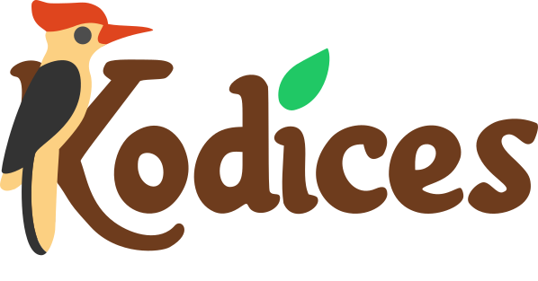

# Kodices

[](LICENSE)

[](https://github.com/Iktwo/Kodices/actions/workflows/publish.yml)

Kodices is a Server-Driven UI framework for Kotlin Multiplatform. It allows you to define your user interfaces using JSON, which can be fetched from a server at runtime. This enables you to update your app's UI without shipping a new version to the app store. A reference implementation and an example that use Compose multiplatform are provided, however you can integrate Kodices with Native UI or other UI frameworks.

## Repository content

This repository contains different modules to help you get started:

```
+--------------+     +--------------------+     +-----------------+
|              |     |                    |     |                 |
|  KodexServer |---->|     Kodices        |---->|   Piktographs   |
| (JSON source)|     | (Core functonality)|     | (Reference UI)  |
|              |     |                    |     |                 |
+--------------+     +--------------------+     +-----------------+
```

*   **KodexServer**: A sample Ktor server that provides the JSON UI definitions. (*Note: This module is currently a work-in-progress.*)
*   **Kodices**: The core module that parses the JSON and creates a platform-agnostic model of the UI.
*   **Piktographs**: A reference implementation that renders the UI models using Jetpack Compose for Android, iOS, and Desktop.
*   **SampleApp**: An example application that demonstrates how to use these components together.
*   **KodexRenderer**: A JVM server that renders screens through Piktographs to PNG images, for e-ink dashboards.

## Getting Started

To get started, clone the repository and build the project.

1.  **Clone the repository:**
    ```bash
    git clone https://github.com/Iktwo/Kodices.git
    cd Kodices
    ```

2.  **Build the project:**
    This command will build all the modules and make them ready for use.
    ```bash
    ./gradlew build
    ```

3.  **Run the SampleApp:**
    The easiest way to see Kodices in action is to run the `SampleApp` on your desktop.
    ```bash
    ./gradlew :SampleApp:run
    ```
    You should see a window with the sample application, which demonstrates various features of the Kodices framework.

## Usage

You can add Kodices to your own Kotlin Multiplatform project by adding the following dependencies to your `build.gradle.kts` file.

```kotlin
dependencies {
    // Core parsing logic
    implementation("com.iktwo:kodices:<latest_version>")

    // Jetpack Compose UI rendering
    implementation("com.iktwo:piktographs:<latest_version>")
}
```
*Please replace `<latest_version>` with the latest version from the [releases page](https://github.com/Iktwo/Kodices/releases).*

Here is a minimal example of how to parse a JSON string and render it with `Piktographs`:

```kotlin
import com.iktwo.kodices.KodicesParser
import com.iktwo.piktographs.PageUI
import androidx.compose.runtime.Composable

@Composable
fun MyScreen(jsonString: String) {
    // 1. Initialize the parser
    val kodicesParser = KodicesParser()

    // 2. Parse the JSON string into a Content object
    val content = kodicesParser.parseJSONToContent(jsonString)

    // 3. Render the content using PageUI
    if (content != null) {
        PageUI(content)
    }
}
```

## Rendering server

[KodexRenderer](KodexRenderer/README.md) renders Kodices screens through Piktographs **headlessly**
to PNG images served over HTTP, so an e-ink tablet can show a server-driven dashboard by polling for
a picture (self-hosted, in the spirit of TRMNL). It is a separate JVM module because Compose UI
cannot run on Kotlin/Native.

```shell
./gradlew :KodexRenderer:run            # http://localhost:8090
./gradlew :KodexRenderer:renderSample   # KodexRenderer/build/render/dashboard.png, no server
```

| Endpoint | |
|---|---|
| `GET /health` | `200 ok` |
| `GET /display?device=<id>` | `{"image_url": "/render/dashboard.png?width=954&height=1696&mode=gray16", "refresh_seconds": 900, "etag": "..."}` |
| `GET /render/{screen}.png?width=&height=&mode=` | PNG (`mode` = `gray16` default, `bw`, `color`) with a strong `ETag`; `304` on a matching `If-None-Match` |
| `GET /render/{screen}.json` | The screen's source JSON |

To add a screen, put `<name>.json` (any Kodices content, optionally wrapped as
`{"content": ..., "data": ...}`) in `KodexRenderer/screens/`; it is served at `/render/<name>.png`
with no restart. Screens can show the current date through the injected `now` data, and bundled
images through `asset:<file>` URLs. Set `KODEX_TOKEN` to require a bearer token. Configuration,
Docker and the rendering details are in the [module README](KodexRenderer/README.md).

## Subprojects

*   [**Kodices**](Kodices/README.md): The core KMP library for parsing UI models.
*   [**Piktographs**](Piktographs/README.md): A reference UI implementation using Compose Multiplatform.
*   [**SampleApp**](SampleApp/README.md): A sample application demonstrating the usage of the library.
*   [**KodexServer**](KodexServer/README.md): A sample Ktor-based server for serving UI models.
*   [**KodexRenderer**](KodexRenderer/README.md): Headless renderer serving screens as e-ink ready PNGs.
